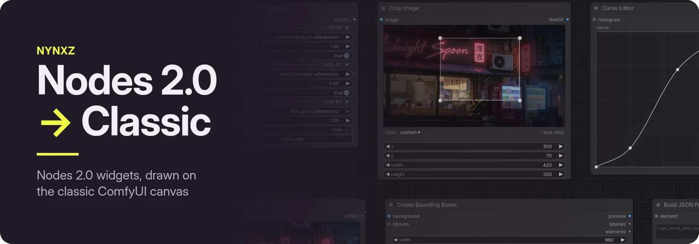
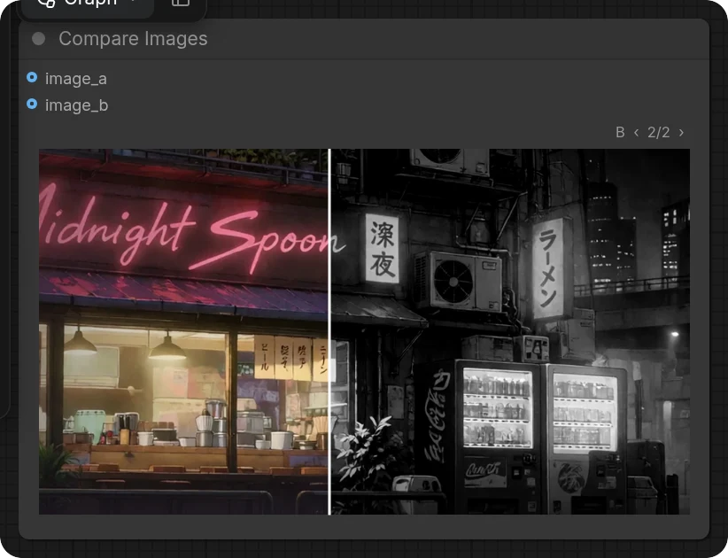
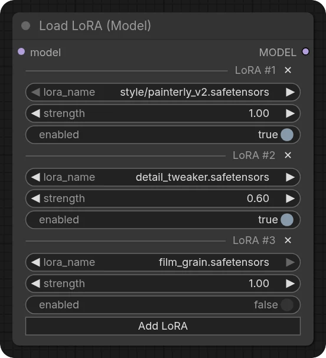
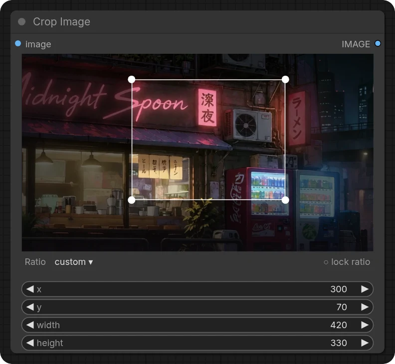
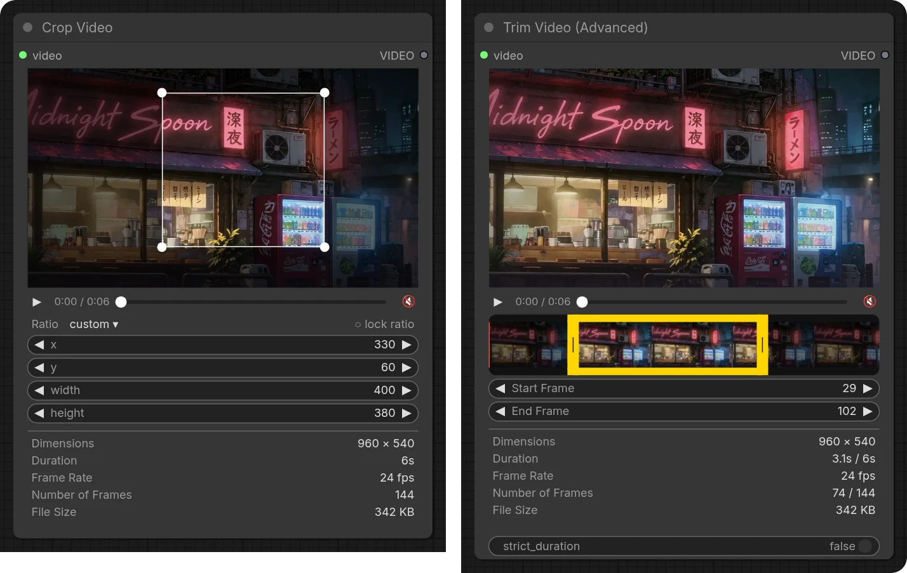
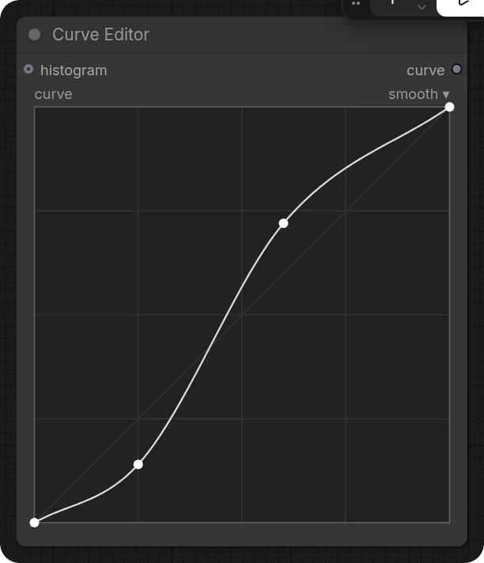
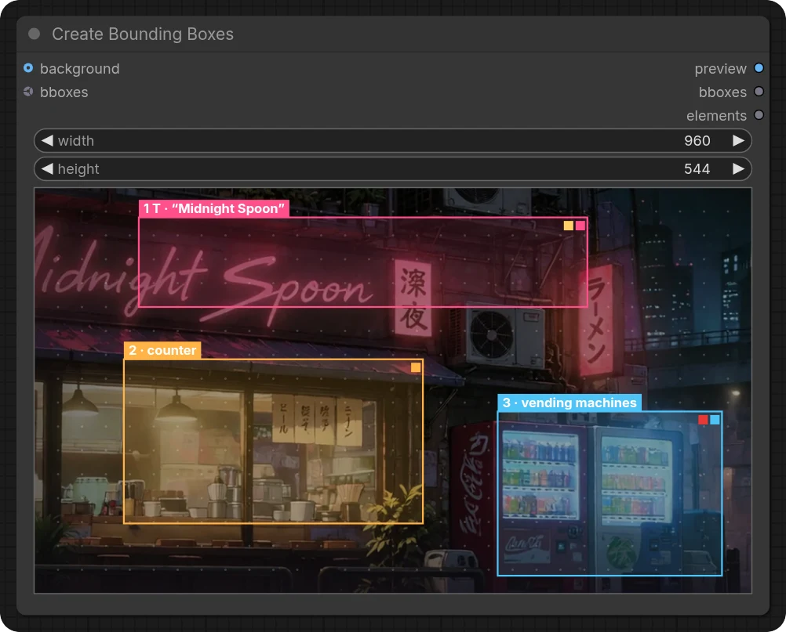
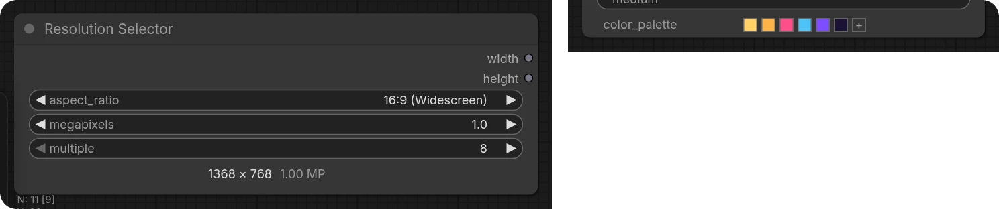

Some ComfyUI widgets only work in Nodes 2.0 — on the classic canvas they show a "Node 2.0 only"
placeholder, or nothing at all. This pack draws them on the classic canvas, so those nodes work in
both. Nodes 2.0 is left exactly as it is.

## Compare Images

Drag across the image to move the split. When a side has a batch, step through it with `‹ ›`.



## LoRA stacks

**Load LoRA (Model)** and **Load LoRA (Text Encoder)** rows, with the same headers as Nodes 2.0:
`✕` removes a row, **Add LoRA** adds one. Works for any node built on the same repeating-group input.



## Crop Image

Drag the box to move it, its edges and corners to resize, or drag on the image to draw a new one.
Pick a ratio or lock the current one, as in Nodes 2.0; hold <kbd>Shift</kbd> to keep the shape
while resizing.



## Crop Video and Trim Video

Play, scrub and mute the clip. Trim on the filmstrip or by frame number; crop on the frame or by
the numbers. Frame rate, duration and frame counts come from the file itself, the same numbers the
nodes run with.



## Curve Editor

Click to add a point, drag to move it, double-click to remove it. Switch between smooth and linear
from the top right. The histogram shows once the node has run.



## Create Bounding Boxes

Drag to draw a box, drag a box to move it, drag its edges to resize. Click a box to set its type,
text, description and palette, reorder it or delete it. A background image sets the canvas size,
and the dot grid can be turned off from the empty-area menu.



## Colours and resolution

The Ideogram colour palette — click a swatch to change or remove it, drag to reorder, `+` to add —
and the Resolution Selector's width × height readout.



## Install

```bash
cd ComfyUI/custom_nodes
git clone https://github.com/Nynxz/ComfyUI-Nodes2Classic
```

Then restart ComfyUI. Nothing to build, and no extra Python packages.

## How it works

The frontend already creates these widgets on the classic canvas; it just doesn't draw them there.
The pack adds a canvas drawing to each one and leaves its value, saving and execution to the
frontend, so workflows are the same in either view. The widgets that are a node's own editor have
no input socket, like ZenKit's socketless widgets.

The art in these screenshots is from *Neon After Midnight*. The code is MIT licensed.
